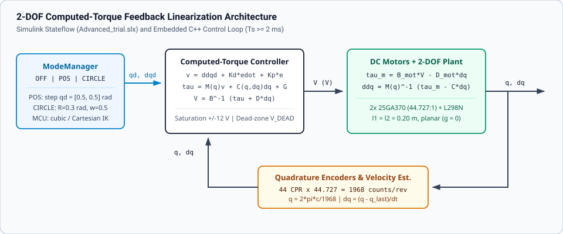
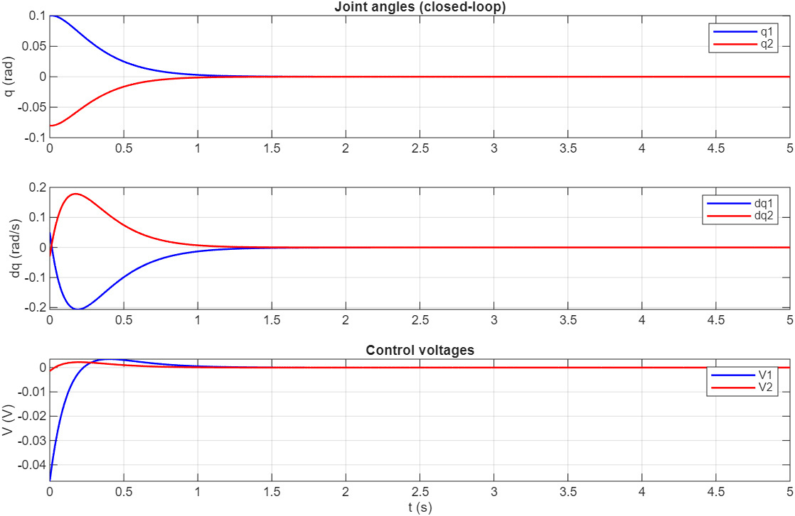
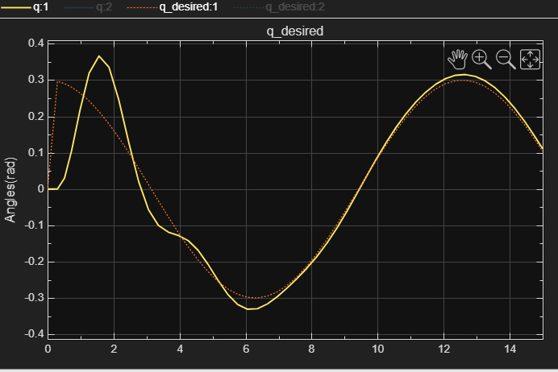
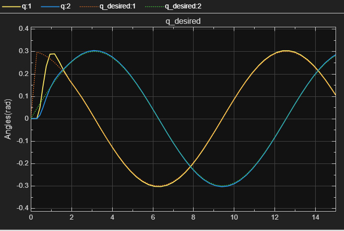
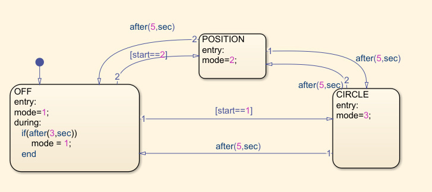
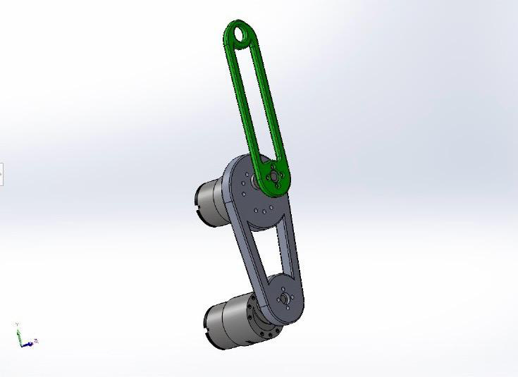
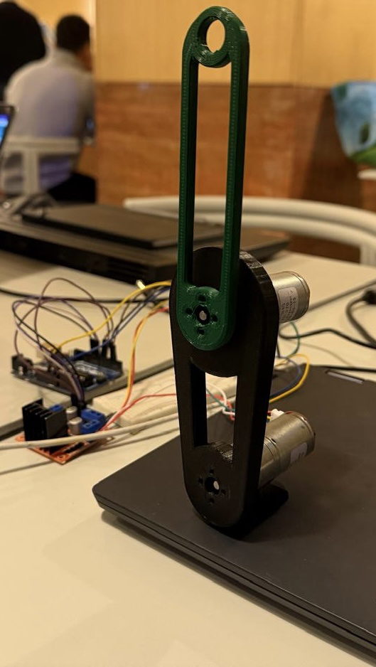
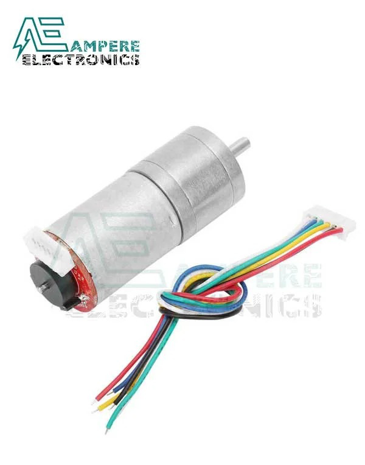
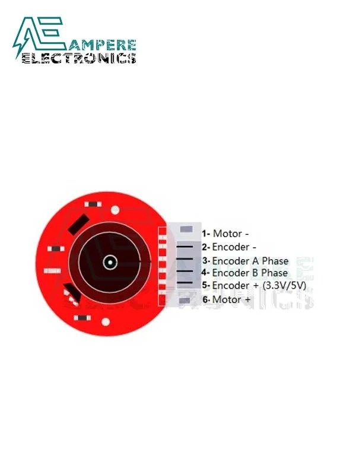

# 2-DOF Robotic Arm Control System

[](https://github.com/andrew-abdelmalak/2-dof-robotic-arm-control-system/actions/workflows/ci.yml)
[](https://github.com/andrew-abdelmalak/2-dof-robotic-arm-control-system/actions/workflows/paper.yml)
[](LICENSE)
[](pyproject.toml)
[](https://github.com/andrew-abdelmalak/2-dof-robotic-arm-control-system/releases)

We designed, simulated, and built a nonlinear computed-torque control system for a 2-DOF planar robotic arm, spanning Euler-Lagrange modeling, Lie-bracket controllability analysis, Simulink Stateflow simulation, and Arduino C++ firmware.

This repository packages our IEEE-style project paper ([PDF](docs/Nonlinear_Control_2DOF_Arm.pdf) | [LaTeX source](paper/Nonlinear_Control_2DOF_Arm.tex)), portable MATLAB and GNU Octave verification scripts, the original Simulink Stateflow model, four embedded firmware sketches, and a pure-Python verification suite so engineers and recruiters can reproduce every analytical and simulation result without a MATLAB license or physical hardware.



## Quick start

### 1. Python numerical verification and ODE simulation

Requires Python 3.11+ and [`uv`](https://docs.astral.sh/uv/).

```bash
git clone https://github.com/andrew-abdelmalak/2-dof-robotic-arm-control-system.git
cd 2-dof-robotic-arm-control-system
uv sync
uv run python -m arm_control
uv run pytest -v
```

Expected output from `uv run python -m arm_control`:

```text
=== 2-DOF Robotic Arm Control Verification ===
m1_total = 0.05259 kg, m2_total = 0.05289 kg
I1_total = 9.428400e-05 kg*m^2, I2_total = 2.187510e-05 kg*m^2
det(M(0)) = 5.172178e-08 kg^2*m^4
Linear controllability rank = 4/4, observability rank = 4/4
Lyapunov P eigenvalues = [0.04273 0.05177 1.45864 1.67155]
Pole-placement nonlinear final ||x|| (t=5s) = 3.5865e-09
Lie-bracket grid (14400 pts): singular=0, min_sv=322.2941
POS step (0.5, 0.5) [Kp=50, Kd=10]: ts=0.84s, overshoot=2.1605e-02 rad, ss_err=3.6947e-11 rad
CIRCLE [Kp=50, Kd=10]: amp_err=0.498%, phase_err=0.00050 rad
CIRCLE [Kp=5, Kd=1]: peak_q1=0.3979 rad at t=1.32s, amp_err=5.43%
Cartesian IK circle max round-trip error = 5.7220e-17 m
```

### 2. GNU Octave or MATLAB analysis

Both `matlab/check_controllability.m` and `matlab/check_nonlinear_controllability_lie.m` run in GNU Octave 9+ without commercial toolboxes or in MATLAB R2025b:

```bash
octave --no-gui --eval "addpath('matlab'); check_controllability; check_nonlinear_controllability_lie"
```

To run the interactive supervisory simulation in MATLAB/Simulink, run `matlab/init_params.m` first to populate `params` (17x1) and `motor` (4x1) in the workspace, then open `matlab/Advanced_trial.slx`.

### 3. Firmware compilation (`arduino-cli`)

All four sketches under `arduino/` compile cleanly for `arduino:avr:mega` (and retain native `ARDUINO_ARCH_ESP32` pin and `ledc` PWM paths):

```bash
for s in arduino/end_effector_circle arduino/joint_space arduino/nonlinear_trajectory arduino/nonlinear_trajectory_alt; do
  arduino-cli compile --fqbn arduino:avr:mega "$s"
done
```

### 4. Paper build (TeX Live)

```bash
cd paper
latexmk -pdf -interaction=nonstopmode Nonlinear_Control_2DOF_Arm.tex
```

## Hardware vs. software reproduction scope

| Scope | What it covers | Source |
| :--- | :--- | :--- |
| **Original hardware bench tests** | 3D-printed PLA+ links, two 12 V 25GA370 DC gear motors (`44.727:1` measured ratio), quadrature encoder calibration (`1968 counts/rev`), L298N H-bridge drive, and closed-loop firmware bench trials | [Paper](docs/Nonlinear_Control_2DOF_Arm.pdf), `arduino/` |
| **Simulink model (MATLAB R2025b)** | Interactive 3-mode Stateflow supervisory logic (`OFF`, `POS`, `CIRCLE`) and continuous-time plant/controller blocks | `matlab/Advanced_trial.slx` |
| **Reproducible without hardware** | Euler-Lagrange dynamics, Kalman controllability/observability, pole placement, Lyapunov $P \succ 0$, 14,400-point Lie-bracket grid, ODE step/circle tracking, AVR firmware compilation, and LaTeX PDF build | `src/arm_control/`, `tests/`, `matlab/*.m`, CI |

## Mathematical model and controllability

We model the horizontal planar 2-DOF manipulator ($g = 0$) coupled to voltage-driven DC gear motors ($\tau_m = B_{\text{mot}} V - D_{\text{mot}} \dot{q}$):

$$M(q)\ddot{q} + C(q,\dot{q})\dot{q} + G(q) = B_{\text{mot}} V - D_{\text{mot}}\dot{q}$$

The computed-torque controller cancels configuration-dependent inertia, Coriolis/centrifugal coupling, and back-EMF damping to enforce linear second-order error dynamics $\ddot{e} + K_d \dot{e} + K_p e = 0$:

$$V = B_{\text{mot}}^{-1}\Big(M(q)(\ddot{q}_d + K_d\dot{e} + K_p e) + C(q,\dot{q})\dot{q} + G(q) + D_{\text{mot}}\dot{q}\Big)$$

| Verification check | Method | Verified result | Source |
| :--- | :--- | :--- | :--- |
| Equilibrium inertia $M(0)$ | Euler-Lagrange parameters | $\det M(0) = 5.172 \times 10^{-8}\text{ kg}^2\cdot\text{m}^4$ | `matlab/init_params.m`, `src/arm_control/dynamics.py` |
| Linear controllability & observability | Kalman rank at $x = 0$ | $\text{rank}(\mathcal{C}) = 4$, $\text{rank}(\mathcal{O}) = 4$ | `matlab/check_controllability.m` |
| Pole placement & Lyapunov stability | Closed-loop poles $\{-4,-5,-6,-7\}$ | $\lambda(P) = \{0.0393, 0.0579, 1.3921, 1.8087\} > 0$ (Octave), $P \succ 0$ | `matlab/check_controllability.m`, `src/arm_control/controllability.py` |
| Nonlinear Lie-bracket controllability | $[g_1, g_2, [f,g_1], [f,g_2]]$ over $120 \times 120$ grid on $[-\pi,\pi]^2$ | $14{,}400 / 14{,}400$ full rank ($4$), $0$ singular points, $\sigma_{\min} = 322.29$ | `matlab/check_nonlinear_controllability_lie.m` |

## Simulation results

<p align="center">
  
</p>
<p align="center"><em>Closed-loop equilibrium response from matlab/check_controllability.m: joint angles converge to zero (top), velocities decay (middle), and control voltages settle (bottom).</em></p>

### Position regulation (`POS` mode)

Commanding a step from $[0, 0]$ to $q_d = [0.5, 0.5]^T\text{ rad}$ with $\pm 12\text{ V}$ actuator limits demonstrates the speed-vs-effort trade-off across PD gain pairs:

| Gain configuration | 2% settling time | Peak overshoot | Steady-state error | Notes |
| :--- | :--- | :--- | :--- | :--- |
| $(K_p, K_d) = (5, 1)$ | $7.57\text{ s}$ | $0.243\text{ rad}$ | $3.15 \times 10^{-3}\text{ rad}$ | Low control effort, lightly damped ($\zeta = 0.22$) |
| $(K_p, K_d) = (10, 3)$ | $2.62\text{ s}$ | $0.092\text{ rad}$ | $1.04 \times 10^{-7}\text{ rad}$ | Faster convergence ($\zeta = 0.47$) |
| $(K_p, K_d) = (50, 10)$ | $0.85\text{ s}$ | $0.0216\text{ rad}$ | $7.88 \times 10^{-11}\text{ rad}$ | Default in `init_params.m` ($\zeta = 0.707$); critical damping at $K_d = 14.14$ removes overshoot |

### Joint-space circular trajectory (`CIRCLE` mode)

In `matlab/Advanced_trial.slx`, `circle_traj` commands $q_{d1} = 0.3\cos(0.5t)\text{ rad}$ and $q_{d2} = 0.3\sin(0.5t)\text{ rad}$ ($R = 0.3\text{ rad}$, $\omega = 0.5\text{ rad/s}$) with `qd_ddot = [0; 0]` in the controller:

| Gain configuration | Steady-state amplitude error | Steady-state phase lag | Initial transient behavior |
| :--- | :--- | :--- | :--- |
| $(K_p, K_d) = (5, 1)$ | $5.43\%$ | $0.068\text{ rad}$ | Initial overshoot near $0.37\text{ rad}$ at $t \approx 1.6\text{ s}$ (left) |
| $(K_p, K_d) = (50, 10)$ | $0.498\%$ ($< 1\%$) | $0.00050\text{ rad}$ ($< 0.02\text{ rad}$) | Settles onto reference within $1.5\text{ s}$ (right) |

<p align="center">
  &nbsp;
  
</p>
<p align="center"><em>Left: low-gain Simulink circular trajectory response showing initial overshoot before settling. Right: tuned high-gain tracking with under 1% amplitude error and under 0.02 rad phase lag.</em></p>

<p align="center">
  
</p>
<p align="center"><em>Stateflow ModeManager state machine switching between OFF, POSITION, and CIRCLE modes.</em></p>

## Hardware design and embedded firmware

We fabricated the 2-DOF planar structure in 3D-printed PLA+ from SolidWorks CAD (`l1 = l2 = 0.200 m` in the nominal model), driven by two 12 V 25GA370 DC gear motors through an L298N dual H-bridge.

<p align="center">
  &nbsp;
  
</p>
<p align="center">
  &nbsp;
  
</p>

All four firmware sketches share a minimum loop period `dt >= 0.002 s` (up to 500 Hz), compute finite-difference joint velocities, clip commands at $\pm 12\text{ V}$ for 8-bit PWM output, and scale encoder counts using our measured gearbox ratio (`44.0 CPR * 44.727 = 1968 counts/rev`, $0.183^\circ/\text{count}$):

| Sketch | Trajectory & control law | Target MCU | Bench-tuned notes |
| :--- | :--- | :--- | :--- |
| [`arduino/joint_space`](arduino/joint_space/joint_space.ino) | Joint-space circle ($R = 60^\circ$, $\omega = 1.5\text{ rad/s}$) with decoupled computed torque and `V_DEAD = 1 V` | Arduino AVR (`PCINT1_vect` on `A4`/`A5`) | Uses bench-tuned effective masses (`m1 = 1.11 kg`, `m2 = 1.11 kg`), `Kp = [8000, 20000]`, `Kd = [500, 500]` |
| [`arduino/end_effector_circle`](arduino/end_effector_circle/end_effector_circle.ino) | Cartesian circle ($R = 0.04\text{ m}$ around $(0.18, 0.00)\text{ m}$) via analytical IK | ESP32 + AVR shim | Uses `l1 = 0.12 m`, `l2 = 0.15 m`, single-edge `RISING` interrupt on Encoder 2 to mitigate noise |
| [`arduino/nonlinear_trajectory`](arduino/nonlinear_trajectory/nonlinear_trajectory.ino) | 1-DOF serial-commanded (`T<deg>`) cubic rest-to-rest `MOVE` ($1.5\text{ s}$) + dead-zone `HOLD` (`V_DEAD = 2 V`) | Arduino AVR | `Kp_move = 50, Kd_move = 10`, `Kp_hold = 30, Kd_hold = 4` |
| [`arduino/nonlinear_trajectory_alt`](arduino/nonlinear_trajectory_alt/nonlinear_trajectory_alt.ino) | 2-DOF serial-commanded cubic `MOVE` + dead-zone `HOLD` (`V_DEAD = 2 V`) | ESP32 + AVR shim | Preserved experimental variant: `MOVE` applies `ddq_d + Kp*e + Kd*ed` directly as voltage without inertia or $b_\tau^{-1}$ scaling |

## Limitations

- The analytical model and simulations operate in the horizontal plane ($g = 0$); vertical operation requires enabling the gravity compensation term $G(q)$ already implemented in `Advanced_trial.slx` and `src/arm_control/dynamics.py`.
- Gearbox stiction and backlash are not modeled in the continuous ODE; the hardware sketches compensate for static friction empirically via `V_DEAD` thresholds (`1 V` to `2 V`).
- High-rate finite-difference velocity estimation amplifies encoder quantization noise ($0.183^\circ/\text{count}$ in $4\times$ quadrature), motivating exponential velocity smoothing or higher-PPR encoders.
- Peak actuator commands saturate at $\pm 12\text{ V}$ across the L298N driver.

## Repository structure

```text
.
|-- arduino/                   # Four AVR/ESP32 firmware sketches
|-- assets/                    # Social preview SVG and 1280x640 PNG
|-- docs/                      # Compiled IEEE PDF and figures/diagrams
|-- matlab/                    # init_params.m, controllability scripts, Advanced_trial.slx
|-- paper/                     # Overleaf-synced LaTeX source and IEEEtran.cls
|-- src/arm_control/           # Python Euler-Lagrange, controllability, and ODE suite
|-- tests/                     # 25 pytest unit and integration tests
|-- CITATION.cff               # Citation metadata for software and paper
|-- CHANGELOG.md               # Keep a Changelog history
`-- pyproject.toml             # uv-managed Python dependencies and Ruff/pytest config
```

## Authors and acknowledgments

| Name | Affiliation |
| :--- | :--- |
| **Ahmed Mostafa** | Mechatronics Engineering, German University in Cairo (GUC) |
| **Andrew Abdelmalak** | Mechatronics Engineering, German University in Cairo (GUC) |
| **Hazim Alwakad** | Mechatronics Engineering, German University in Cairo (GUC) |
| **Mazen Amr** | Mechatronics Engineering, German University in Cairo (GUC) |
| **Samir Yacoub** | Mechatronics Engineering, German University in Cairo (GUC) |
| **Youssef Youssry** | Mechatronics Engineering, German University in Cairo (GUC) |

We thank **Prof. Ayman A. El-Badawy** and **Eng. Karim Abdelsalam** for their guidance and supervision in MCTR 903 (Advanced Mechatronics Engineering) at the German University in Cairo.

## Contributing, citation, and license

See [CONTRIBUTING.md](.github/CONTRIBUTING.md) for local setup and checks, [SECURITY.md](.github/SECURITY.md) to report vulnerabilities privately, and [CITATION.cff](CITATION.cff) for BibTeX/APA citation metadata.

Released under the MIT License. See [LICENSE](LICENSE).
